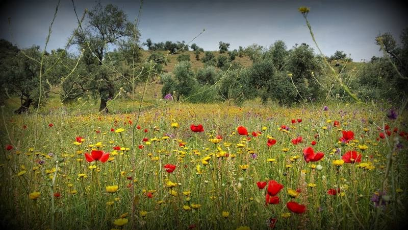

---
output:
  html_document:
    theme: null
    toc: false
    self_contained: false
    css: style.css
    includes:
      before_body: _includes/experience-en-before.html
      after_body: _includes/experience-en-after.html
---

Academic trajectory
<h1>Experience &amp; education</h1>
Degrees, appointments and research visits — an academic timeline.

<section class="section" id=""><h2>Appointments &amp; visits</h2>

<strong>2019–2023</strong> — Teaching appointment / PCC · École polytechnique, CMAP

<strong>Sept.–oct. 2015</strong> — Visiting researcher · Georgia Institute of Technology, Atlanta

<strong>2009–present</strong> — Associate Professor of Applied Mathematics · Université Paris Dauphine–PSL, CEREMADE (CNRS UMR 7534)

<strong>2008–2009</strong> — ATER · Université Paris Diderot, LPMA

</section><section class="section" id=""><h2>Education</h2>

<strong>2008</strong> — PhD in Statistics · Université Paris Diderot

<strong>2005</strong> — Research Master’s in stochastic modelling and statistics · Université Paris Diderot

<strong>2004</strong> — Maîtrise in Applied Mathematics · Université Pierre-et-Marie-Curie

</section><section class="section" id=""><h2>Biography</h2>
My research began in nonparametric statistics, inverse problems and quantum tomography. It subsequently expanded to neural-network generalization, contrastive methods, clustering and robust distributed learning. My academic work connects foundational research, doctoral supervision, teaching and collaborations with institutional and industry partners.

Kabylie · personal photograph

My current research includes causal and counterfactual inference and a developing direction in adversarial machine learning, with attacks, defenses, data ownership verification and efficiency as research questions.
</section>
<aside class="contact-card" aria-label="Contact">
CEREMADE · DAUPHINE–PSL
<h2>Contact</h2>
Email

meziani[arobase]ceremade[dot]dauphine[dot]fr

Office address
<address>Laboratoire CEREMADE Université Paris Dauphine–PSL Place du Maréchal de Lattre de Tassigny 75016 Paris France</address></aside>

